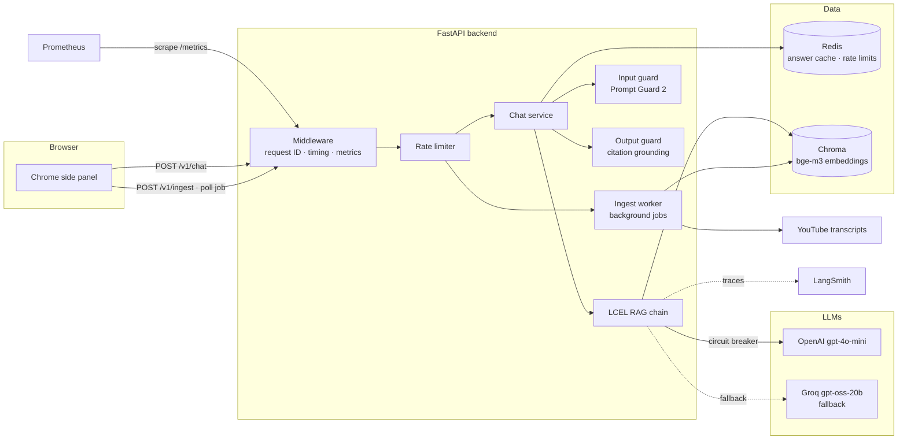

# YouTube RAG Chat

Ask questions about the YouTube video you are watching, in English or Italian, and get answers grounded in the video's transcript with **clickable timestamps** that jump the player to the exact moment.

A Chrome side-panel extension talks to a FastAPI backend that runs a Retrieval-Augmented Generation (RAG) pipeline built with LangChain. Beyond the basic RAG, the project focuses on what production systems need: fault tolerance, guardrails, caching, rate limiting, background jobs, observability, tests and containerized deployment.

---

## Architecture



### Request flow: chat

1. **Validation** at the boundary (Pydantic): video ID format, question length, language.
2. **Rate limit** per client (moving window, `429` + `Retry-After`).
3. **Video indexed?** If not, `409 video_not_indexed`.
4. **Answer cache** (Redis). A hit returns in ~20 ms and skips everything below.
5. **Input guardrail**: Meta's Prompt Guard 2 classifies prompt-injection attempts.
6. **Retrieval**: bge-m3 embeds the question, Chroma returns the top-k chunks above a calibrated similarity threshold. No relevant chunks means the LLM is **not called** ("not covered" answer).
7. **Generation**: OpenAI behind a circuit breaker, with automatic fallback to Groq.
8. **Output guardrail**: every cited `[mm:ss]` must fall inside a retrieved chunk, otherwise the system abstains.
9. **Cache store** and response with deep links to the cited moments.

### Request flow: ingestion

`POST /v1/ingest` returns `202 Accepted` with a `job_id` immediately. A bounded worker pool fetches the transcript, splits it into timestamped chunks and embeds them. The client polls `GET /v1/ingest/{job_id}` until `completed` or `failed`. Requests for a video already being processed return the same job (deduplication), and already-indexed videos are skipped (idempotency).

---

## Key design decisions

| Decision | Why |
|---|---|
| **Layered architecture** (api → services → domain → infrastructure) | Vendors (OpenAI, Chroma, Redis) sit behind interfaces, so swapping one changes a single file. |
| **Timestamp-preserving chunking** | LangChain's `RecursiveCharacterTextSplitter` with `add_start_index`, mapped back to transcript segments by binary search, so every chunk knows its start/end second. |
| **bge-m3 embeddings (local, multilingual)** | Italian questions match English transcripts. Replaced multilingual-e5 after measuring: e5 separated relevant from irrelevant questions by only ~0.01 in similarity, bge-m3 by ~0.18, which makes a threshold usable. |
| **Deterministic chunk IDs** | `videoId:lang:index` → upserts instead of duplicates; re-ingestion is idempotent. |
| **LLM fallback only on transient errors** | Timeouts, rate limits, 5xx trigger fallback. Auth or bad-request errors surface as bugs instead of silently burning the fallback. |
| **Circuit breaker** | During an outage, requests skip the dead provider instantly instead of each waiting for timeouts. |
| **Versioned cache keys** | Prompt version + model names are part of the key, so changing either invalidates old answers automatically. |
| **Abstain over hallucinate** | No relevant chunks or invalid citations → "this video doesn't cover that". |
| **One error contract** | Every error is `{"error": {"code", "message", "request_id"}}`; clients switch on `code`. |
| **Fail-open input guard** | If the guard provider is down, requests continue and a warning is logged; the hardened prompt is a second layer. Configurable. |

---

## Measured results (local, single machine)

| What | Before | After |
|---|---|---|
| Repeated question (answer cache) | 8,112 ms | **19 ms** |
| Requests during an OpenAI outage (circuit breaker) | ~11.5 s each | **0.08–0.27 s** (Groq) |
| First retrieval after startup (embedding warm-up) | 2.34 s | **0.18 s** |
| Prompt Guard score: normal question vs injection | 0.0004 | 0.9996 |
| Docker rebuild after a code change (layer caching) | ~6 min | **~5 s** |

Typical uncached answer: ~2 s, of which ~90% is the LLM call (measured with LangSmith traces).

---

## Tech stack

**Backend:** Python 3.12, FastAPI, Pydantic, uv
**RAG:** LangChain (LCEL), Chroma, BAAI/bge-m3 (sentence-transformers), youtube-transcript-api
**LLMs:** OpenAI gpt-4o-mini (primary), Groq openai/gpt-oss-20b (fallback), Meta Prompt Guard 2 (guardrail)
**Infrastructure:** Redis, Docker, Docker Compose
**Observability:** structured JSON logs, LangSmith tracing, Prometheus metrics
**Quality:** pytest, pytest-asyncio
**Client:** Chrome extension (Manifest V3, side panel, vanilla JS)

---

## Getting started

### Prerequisites
- Python 3.12 and [uv](https://docs.astral.sh/uv/)
- An OpenAI API key and a Groq API key
- Optional: a LangSmith API key (tracing), Docker Desktop

### Configuration
Copy `.env.example` to `.env` and fill in the keys:

```
OPENAI_API_KEY=
GROQ_API_KEY=
ENV=dev
LOG_LEVEL=INFO
LANGSMITH_TRACING=false
LANGSMITH_API_KEY=
```

All settings live in `app/core/config.py` (typed, validated at startup). Any of them can be overridden with an environment variable, for example `RATE_LIMIT_CHAT=20/minute` or `SIMILARITY_THRESHOLD=0.45`.

### Run locally
```bash
uv sync
uv run uvicorn app.main:app --reload
```
Open http://127.0.0.1:8000/docs for the interactive API docs.

### Run with Docker (API + Redis + Prometheus)
```bash
docker compose up --build -d
docker compose ps
```
- API: http://127.0.0.1:8000
- Prometheus: http://127.0.0.1:9090

### Load the Chrome extension
1. Open `chrome://extensions` and enable **Developer mode**.
2. Click **Load unpacked** and select the `extension/` folder.
3. Open a YouTube video and click the extension icon.

---

## API

| Method | Path | Description |
|---|---|---|
| `GET` | `/health` | Liveness: the process is up. |
| `GET` | `/ready` | Readiness: vector store reachable, LLM status from startup check, circuit breaker state. |
| `POST` | `/v1/ingest` | Start indexing a video → `202` with `job_id` and `Location` header. |
| `GET` | `/v1/ingest/{job_id}` | Job status: `pending`, `running`, `completed`, `failed`. |
| `POST` | `/v1/chat` | Ask a question about an indexed video. |
| `GET` | `/metrics` | Prometheus metrics. |

Example:
```bash
curl -X POST http://127.0.0.1:8000/v1/chat \
  -H "Content-Type: application/json" \
  -d '{"video_id": "iG9CE55wbtY", "question": "What does he say about dance?", "language": "en"}'
```
```json
{
  "answer": "He says dance is as important as mathematics ... [17:01]",
  "covered": true,
  "sources": [{"start": 1021.3, "end": 1074.8, "url": "https://youtu.be/iG9CE55wbtY?t=1021"}]
}
```

Error codes: `invalid_input` (422), `guardrail_blocked` (400), `video_not_indexed` (409), `job_not_found` / `transcript_not_found` (404), `rate_limited` (429), `upstream_error` (502), `service_unavailable` (503).

---

## Observability

- **Logs:** JSON in production, one line per request with `request_id`, path, status and duration. The same `request_id` is returned in the `X-Request-ID` header and attached to LangSmith traces.
- **Traces:** LangSmith shows each chain run as a tree (retriever, prompt, LLM) with latency and token counts.
- **Metrics:** HTTP latency histogram, cache hits/misses, chat outcomes, guardrail blocks, ingest jobs, LLM calls/latency/tokens per model (fallback rate comes for free), circuit breaker state.

---

## Tests

```bash
uv run pytest -v
```
24 unit and API tests covering the output guard, cache (normalization, TTL, failure handling), circuit breaker state transitions, chat service flows and the HTTP contract. They use fakes injected through constructors and FastAPI dependency overrides: no network, no models, no API keys, ~3 seconds.

---

## Project structure

```
app/
├── main.py              # app factory + lifespan (warm-up, LLM checks)
├── core/                # config, logging, domain exceptions
├── api/                 # routes (v1), dependencies, error handlers, rate limiting, middleware
├── schemas/             # request/response contracts
├── services/            # chat + ingest orchestration
├── ingestion/           # transcript fetcher, timestamp-aware chunker
├── rag/                 # embeddings, vector store, LLMs, prompts, LCEL chain
├── guardrails/          # input (Prompt Guard) and output (grounding) checks
├── resilience/          # circuit breaker
├── cache/               # answer cache (in-memory or Redis)
├── workers/             # background ingest jobs
└── observability/       # tracing setup, Prometheus metrics
extension/               # Chrome side-panel extension
tests/                   # pytest suite
ops/                     # Prometheus config
```

See [COMMANDS.md](COMMANDS.md) for every command used to build, test and debug the project.

---

## Known limitations and next steps

- **Single API replica.** Embedded Chroma, the in-memory job store and per-process metrics assume one instance. Scaling out means a Chroma server (or pgvector), a Redis-backed job queue and per-pod metric scraping.
- **Summaries use top-k retrieval.** "Summarize this video" only sees the 4 most relevant chunks. Planned: intent routing with LangGraph, sending whole-video tasks to a map-reduce summarization branch.
- **Transcripts in Italian and English only.** Planned: server-side transcript translation so videos with only other caption languages work.
- **No authentication.** Rate limits are per IP; per-user API keys are the next step.
- **No streaming.** Answers arrive complete; streaming needs a decision on how to apply the output guard to partial text.
